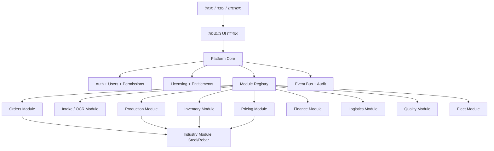
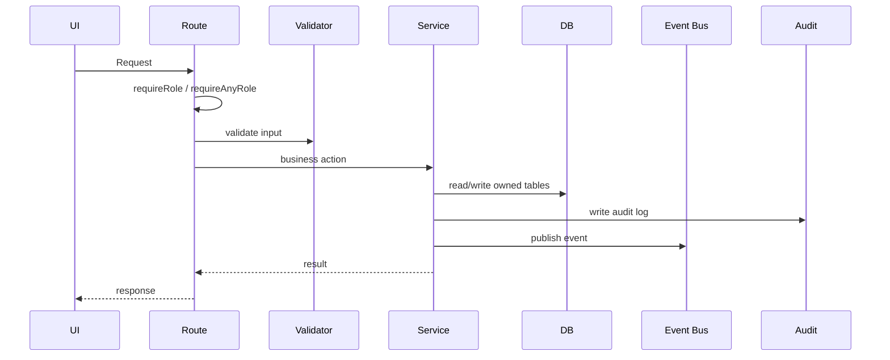
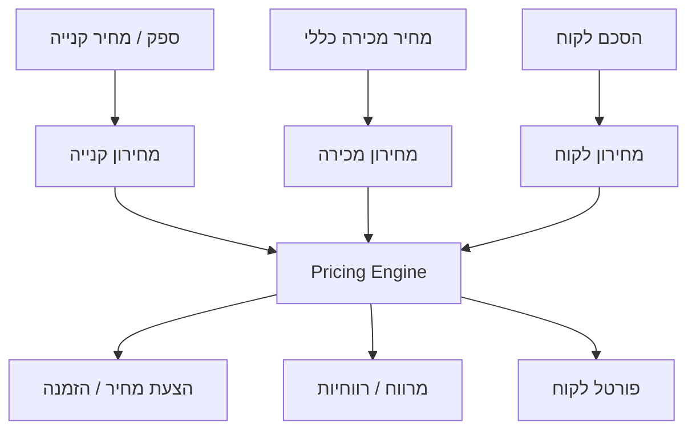
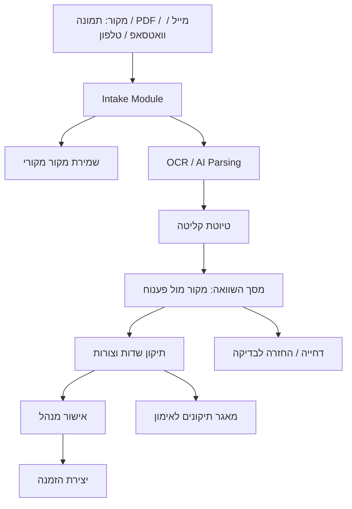
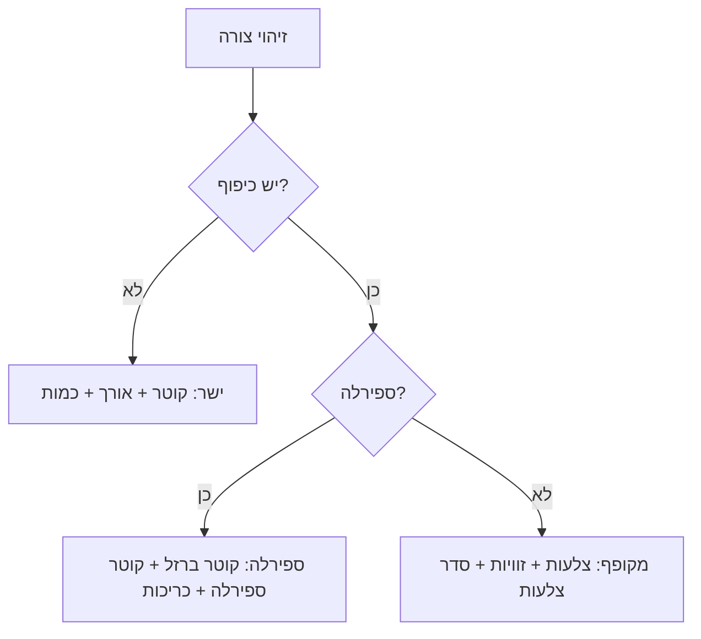
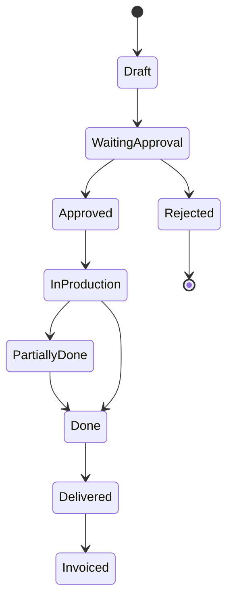
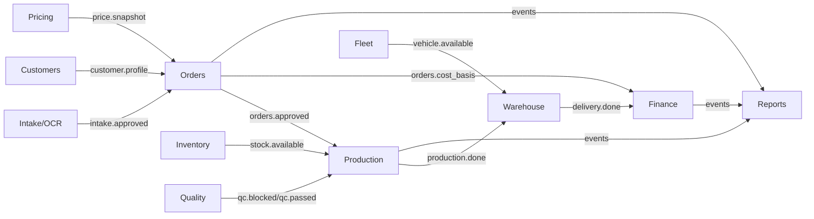
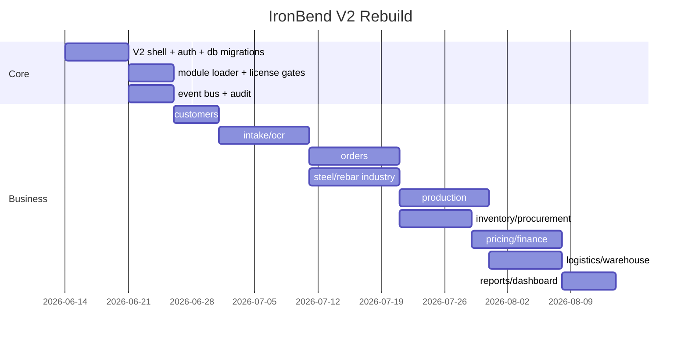

# IronBend V2 — מסמך אמת לפרויקט מודולרי

מסמך זה הוא מקור האמת לבנייה מחדש של IronBend כמערכת תעשייתית מודולרית, נקייה, ניתנת למכירה לפי מודולים, וניתנת להרחבה ללקוחות ותעשיות שונות.

המטרה אינה “לתקן מסך”. המטרה היא לבנות מוצר שאפשר למכור, לתחזק, להפעיל מרחוק, ולפתח עליו מודול חדש בלי לשבור מודול קיים.

---

## 1. משפט מוצר

IronBend היא פלטפורמה לניהול מפעלים ותהליכי ייצור, שמתחילה בענף ברזל/כיפוף ברזל, אבל בנויה כך שכל לקוח יקבל רק את המודולים שהוא רכש: הזמנות, קליטה חכמה, ייצור, מלאי, רכש, מחירונים, כספים, לוגיסטיקה, איכות, צי רכב, דוחות ואינטגרציות.

---

## 2. ההחלטה האדריכלית המרכזית

המערכת נבנית כ־Platform Core + Feature Modules + Industry Modules.



### Core

Core הוא התשתית בלבד:

- התחברות, משתמשים והרשאות.
- רישוי ומודולים פעילים.
- טעינת מודולים.
- Event Bus.
- Audit Log.
- DB connection.
- migrations.
- UI shell וניווט.

Core לא יודע לחשב משקל ברזל, לא יודע איך נראית ספירלה, לא יודע מה זה תעודת משלוח ספק, ולא יודע איך מאשרים הזמנה. אלו שייכים למודולים.

### Feature Module

מודול עסקי עצמאי כמו Orders, Inventory, Finance, Intake.

### Industry Module

מודול ענפי שמגדיר חוקי תחום:

- Steel/Rebar: קטרים, משקלים, צורות כיפוף, BVBS, חישוב אורך, כרטיסי ייצור.
- בעתיד: נגרות, אלומיניום, אריזה, מפעל אחר.

Feature Module יכול להשתמש ב־Industry Module דרך API/Service מוגדר, לא דרך קוד פרטי.

---

## 3. כלל ברזל: אין מונולית

אין `server.js` שמחזיק לוגיקה עסקית.

`server.js` ב־V2 עושה רק:

1. טעינת env.
2. פתיחת DB.
3. טעינת Core.
4. טעינת מודולים לפי רישוי.
5. Mount ל־routes.
6. Health check.
7. הפעלת שרת.

אסור:

- להוסיף route חדש ישירות ל־server.js.
- להוסיף פונקציית עזר עסקית ל־server.js.
- להוסיף SQL עסקי ל־server.js.
- להשתמש ב־global state לא מתועד.

---

## 4. חוזה מודול

כל מודול חייב להיות תיקייה עצמאית עם מבנה קבוע:

```text
modules/
  orders/
    module.manifest.js
    routes.js
    service.js
    schema.sql
    migrations/
    events.js
    validators.js
    permissions.js
    ui/
      orders.html
      orders.css
      orders.js
    tests/
      orders.routes.test.js
      orders.service.test.js
    README_HE.md
```

### module.manifest.js

כל מודול מצהיר מי הוא, מה הוא צורך ומה הוא מפיק.

```js
module.exports = {
  id: 'orders',
  title: 'הזמנות',
  type: 'feature',
  licenseKey: 'orders',
  owns: {
    routes: ['/api/orders'],
    tables: ['orders', 'order_items', 'order_status_history'],
    screens: ['/orders.html', '/index.html?newOrder=1'],
  },
  consumes: [
    { type: 'event', name: 'intake.approved' },
    { type: 'service', module: 'customers', name: 'getCustomer' },
    { type: 'service', module: 'pricing', name: 'quoteOrder' },
  ],
  produces: [
    { type: 'event', name: 'orders.created' },
    { type: 'event', name: 'orders.status_changed' },
  ],
};
```

### routes.js

כל routes הם factory function עם Dependency Injection.

```js
const router = require('express').Router();

function required(name, value) {
  if (!value) throw new Error(`orders module missing dependency: ${name}`);
  return value;
}

module.exports = function createOrdersRouter(deps) {
  const db = required('db', deps.db);
  const requireAnyRole = required('requireAnyRole', deps.requireAnyRole);
  const auditLog = required('auditLog', deps.auditLog);
  const eventBus = required('eventBus', deps.eventBus);
  const orders = required('ordersService', deps.ordersService);

  router.get('/orders', requireAnyRole(['sales', 'manager', 'admin']), async (req, res) => {
    const result = await orders.list(req.query);
    res.json(result);
  });

  return router;
};
```

אסור ל־route:

- לפתוח DB חדש.
- לקרוא ישירות לטבלאות של מודול אחר.
- לבצע חישובים עסקיים גדולים.
- להחזיר רשימה בלי pagination.
- לכתוב בלי audit.
- לשנות status בלי status transition.

---

## 5. חמש שורות חובה בכל endpoint

כל endpoint חדש חייב להוכיח:

1. Auth: `requireRole` או `requireAnyRole`.
2. Validation: schema ל־body/query/params.
3. Business service: הלוגיקה ב־service, לא ב־route.
4. Audit: על כל כתיבה.
5. Event: על כל שינוי מצב או פעולה שמודול אחר צריך לדעת עליה.



---

## 6. מקור אמת לנתונים

לכל נתון יש בעלים אחד בלבד.

| תחום | מקור אמת | מי קורא | מי כותב |
|---|---|---|---|
| משתמשים והרשאות | Core/Auth | כולם דרך service | Auth/Admin בלבד |
| לקוחות | Customers | Orders, Finance, Portal | Customers בלבד |
| הזמנות | Orders | Production, Finance, Reports | Orders בלבד |
| פריטי הזמנה | Orders + Industry | Production, Cards | Orders בלבד |
| צורות ברזל | Steel/Rebar | Orders, Production, OCR | Steel/Rebar בלבד |
| מלאי | Inventory | Orders, Production, Finance | Inventory בלבד |
| מחיר קנייה | Pricing/Procurement | Finance, Inventory | Pricing/Procurement |
| מחיר מכירה | Pricing | Orders, Finance, Portal | Pricing |
| מחיר לקוח | Pricing/Customers | Orders, Finance, Portal | Pricing + Customers |
| חשבוניות | Finance | Reports, Portal | Finance בלבד |
| תעודות משלוח | Logistics/Warehouse | Orders, Finance, Portal | Logistics בלבד |
| OCR raw docs | Intake | Orders, Training | Intake בלבד |
| OCR corrections | Intake Training | OCR | Intake בלבד |

אם מודול צריך נתון של מודול אחר, הוא לא נוגע בטבלה ישירות. הוא משתמש ב־service/API/event.

---

## 7. מחירונים — לקח מרכזי

מחירון ברזל משתנה כל הזמן, ולחלק מהלקוחות יש מחירון שהם מכתיבים.

לכן אין “מחירון אחד”.



### כללים

- מחיר קנייה משמש לחישוב עלות ורווחיות.
- מחיר מכירה משמש כברירת מחדל להצעה.
- מחיר לקוח גובר על מחיר מכירה אם קיים.
- אין לערבב בין `purchase_price`, `sales_price`, `customer_price`.
- כל מחיר נשמר עם תוקף תאריך: `valid_from`, `valid_to`.
- כל חישוב כספי נשמר עם snapshot כדי ששינוי מחיר בעתיד לא ישנה הזמנות עבר.

---

## 8. OCR וקליטת הזמנות — לקח מרכזי

OCR לעולם לא יוצר הזמנה סופית בלי אישור.

הזרימה הנכונה:



### מסך השוואה חובה

המשתמש חייב לראות:

- מסמך מקור בצד אחד, עם זום וגלילה.
- טופס פענוח בצד שני, בסגנון טופס הזמנה.
- לכל שורה: צורה ויזואלית, קוטר, אורך/מידות, כמות, משקל משוער, הערות חריגה.
- שדות עם ביטחון נמוך מסומנים.
- לחיצה על צורה פותחת עורך צורה.
- אין להשוות מול “מלל ארוך”. משווים מול נתונים וצורה.

### הערות OCR

הערות AI לא מוצגות כטקסט ענק בכרטיס הזמנה. הן נכנסות ל־Review Details או Log.

---

## 9. חוקי צורות ברזל

צורות הן חלק מ־Industry Module: `steel-rebar`.

### ישר

אם זוהה ברזל ישר:

- אין זוויות.
- יש קוטר.
- יש אורך.
- יש כמות.

### מקופף

אם זוהה ברזל מקופף:

- יש צלעות.
- יש זוויות.
- צריך סדר צלעות ברור.
- עודף אורך מתחלק לקצוות לפי החוק שהוגדר, לא כסתם “הפרש”.

### ספירלה

אם זוהתה ספירלה:

- אין זוויות.
- יש קוטר ברזל.
- יש קוטר ספירלה.
- יש מספר כריכות.
- אופציונלי: פסיעה / גובה אם יש צורך ייצור.

### חישוק

סימון חישוק הוא מלבן/ריבוע עם סימון קטן פנימי בפינה. הסימון תמיד כלפי פנים. זה סמל, לא צלע נוספת.



---

## 10. מודולים ראשיים ב־V2

### 10.1 Core/Auth

מטרה: זהות, הרשאות, כניסה, משתמשים.

Inputs:

- שם משתמש וסיסמה/PIN.
- role.
- הרשאות.

Outputs:

- access token.
- refresh token.
- `req.auth`.
- audit events.

Logic:

- JWT יציב מ־env.
- אין fallback אקראי בייצור.
- role לא מגיע מ־header שניתן לזיוף.
- WebSocket מאומת.

Owned screens:

- login.
- users/admin.
- profile/session.

---

### 10.2 Licensing & Entitlements

מטרה: לקבוע אילו מודולים פתוחים לכל לקוח.

Inputs:

- license key.
- machine/customer id.
- active users count.
- module catalog.

Outputs:

- package.
- enabled modules.
- max users.
- warnings.

Logic:

- Free mode: הכל פתוח לפיתוח/בדיקה אם אין רישיון.
- Production customer: רק מודולים מורשים.
- אכיפת `requireModule(key)` לפני routes.
- חריגת משתמשים היא אזהרה רכה, לא עצירת מפעל באמצע יום.

Owned screens:

- admin/modules.
- license status.

---

### 10.3 Customers

מטרה: ניהול לקוחות, אנשי קשר, כתובות, תנאי מחיר.

Inputs:

- פרטי לקוח.
- אנשי קשר.
- כתובות אספקה.
- תנאי תשלום.
- מחירון לקוח.

Outputs:

- customer profile.
- customer id.
- portal access.
- pricing overrides.

Logic:

- לקוח אינו “שדה בתוך הזמנה”. הוא entity עצמאי.
- במסך הזמנה חדשה מחפשים לקוח או פותחים לקוח מינימלי.
- פרטי עומק של לקוח נמצאים במסך לקוח.

Owned screens:

- customers list.
- customer detail.
- customer pricing.
- customer portal access.

---

### 10.4 Order Intake / OCR

מטרה: קבלת הזמנות מכל מקור והפיכתן לטיוטה לאישור.

Inputs:

- PDF.
- תמונה.
- WhatsApp.
- Email.
- טלפון/ידני.
- CSV/TSV.

Outputs:

- intake draft.
- parsed order lines.
- confidence report.
- source document.
- corrections.
- approved order request.

Logic:

- כל מקור נשמר.
- OCR מייצר טיוטה בלבד.
- אישור תמיד מול מקור.
- הערות דורשות מסלול אישור.
- אם יש שגיאה בשורה, היא מופיעה במרכז קליטה ולא נעלמת בתוך הזמנה.

Owned screens:

- intake center.
- OCR compare.
- OCR training.
- manual intake.

---

### 10.5 Orders

מטרה: ניהול הזמנות מאושרות, סטטוסים, פריטים, שינוי הזמנה.

Inputs:

- intake approved draft.
- manual order.
- customer.
- pricing quote.
- rebar shape items.

Outputs:

- order.
- order items.
- production request.
- cards request.
- finance snapshot.
- status events.

Logic:

- הזמנה יכולה להיווצר רק מלקוח תקין או לקוח זמני ברור.
- שינוי כרטיסיות אחרי ייצור מחייב הדפסת מאסטר חדש.
- פיצול כרטיסיות מחלק כמות וממספר מחדש.
- סטטוסים עובדים רק לפי transition table.

Owned screens:

- orders list.
- order detail.
- new order.
- order edit.
- card split/print.

Order lifecycle:



---

### 10.6 Steel/Rebar Industry

מטרה: חוקי ברזל וכיפוף.

Inputs:

- קוטר.
- צורה.
- צלעות.
- זוויות.
- תקן פלדה.
- כמות.

Outputs:

- אורך פריסה.
- משקל.
- BVBS.
- SVG/visual shape.
- validation warnings.

Logic:

- `rebarKgPerMeter()` מקור אמת אחד.
- אין נוסחאות inline במודולים אחרים.
- צורה ויזואלית חייבת להיות עקבית בין OCR, הזמנה, כרטיס ייצור והדפסה.

Owned screens:

- shape editor.
- shape catalog.
- production card visual.

---

### 10.7 Production

מטרה: ביצוע ייצור בפועל.

Inputs:

- approved order items.
- production cards.
- machine availability.
- worker updates.

Outputs:

- produced quantity.
- actual weight.
- machine status.
- production events.

Logic:

- לכל כרטיס יש משקל רצוי.
- עובד מזין משקל מצוי.
- חריגה באחוזים מייצרת התראה.
- סטטוס כרטיס מתקדם לפי פעולת עובד.

Owned screens:

- worker station.
- machine screen.
- production dashboard.
- card scan/update.

---

### 10.8 Inventory / Procurement

מטרה: מלאי חומר גלם, קבלת חומר, ספקים, תעודות משלוח ספק.

Inputs:

- supplier delivery note.
- manual receiving.
- OCR receiving.
- purchase order.
- steel type/diameter/weight.

Outputs:

- inventory lot.
- stock movement.
- supplier receipt draft.
- approval request.

Logic:

- קבלת חומר למלאי חייבת OCR משלה, לא OCR הזמנות.
- עובד מצלם תעודת משלוח ספק.
- מנהל מאשר מול מקור.
- רק לאחר אישור המלאי מתעדכן.

Owned screens:

- inventory.
- receiving center.
- supplier delivery compare.
- stock movements.

---

### 10.9 Pricing

מטרה: מנוע מחירונים וחישובי מחיר.

Inputs:

- purchase price.
- sales price.
- customer price.
- customer.
- product/shape.
- date.

Outputs:

- quoted unit price.
- cost estimate.
- margin basis.
- price snapshot.

Logic:

- מחיר לקוח גובר על מחיר מכירה.
- מחיר קנייה משמש לעלות.
- כל מחיר מחושב לפי תאריך.
- החישוב מחזיר גם “למה” נבחר המחיר.

Owned screens:

- pricing admin.
- purchase price import.
- customer price list.
- pricing history.

---

### 10.10 Finance

מטרה: עלויות, מרווחים, חשבוניות, אשראי.

Inputs:

- orders.
- pricing snapshots.
- production actuals.
- customer ledger.
- invoices.

Outputs:

- invoice.
- margin.
- customer balance.
- credit warning.

Logic:

- Finance לא מכתיב מחיר; הוא משתמש ב־Pricing snapshot.
- אין כפילות לא מוסברת בין סוגי אשראי.
- כל פעולה כספית נרשמת ב־audit.

Owned screens:

- finance dashboard.
- invoices.
- customer ledger.
- margins.

---

### 10.11 Warehouse / Logistics

מטרה: אספקה, אריזות, תעודות משלוח, משלוחים.

Inputs:

- completed production.
- delivery address.
- vehicle/driver assignment.
- packages.

Outputs:

- delivery note.
- shipment.
- delivery status.

Logic:

- רכב ונהג הם entities נפרדים.
- משלוח שייך ללוגיסטיקה, לא ל־Fleet.
- תעודת משלוח נוצרת מהזמנה/משטחים מאושרים.

Owned screens:

- deliveries.
- packages.
- delivery notes.
- dispatch board.

---

### 10.12 Fleet

מטרה: ניהול רכבים ונהגים.

Inputs:

- vehicles.
- drivers.
- documents.
- insurance/test/service dates.
- expenses.

Outputs:

- vehicle health.
- driver availability.
- document alerts.
- expense reports.

Logic:

- רכב != נהג.
- לכל רכב יש מסמכים, טיפולים, ביטוח, טסט, הוצאות והכנסות.
- Fleet מספק זמינות ללוגיסטיקה, לא מנהל משלוחים בעצמו.

Owned screens:

- vehicles.
- drivers.
- vehicle detail.
- driver detail.
- fleet documents.

---

### 10.13 Quality / Maintenance

מטרה: בקרת איכות, NCR, CAPA, תקלות, תחזוקה.

Inputs:

- quality checks.
- incidents.
- machine faults.
- maintenance logs.

Outputs:

- QC status.
- NCR.
- CAPA.
- machine status update.

Logic:

- איכות יכולה לעצור פריט/הזמנה לפי הרשאות.
- תקלה במכונה מעדכנת מצב מכונה.
- סגירת תקלה מחזירה מצב לפי state machine.

Owned screens:

- quality center.
- maintenance.
- NCR/CAPA.
- incidents.

---

### 10.14 Reports / Dashboard

מטרה: תצוגת בקרה, KPI, דוחות.

Inputs:

- events.
- orders.
- production.
- finance.
- inventory.

Outputs:

- dashboard cards.
- exports.
- KPI charts.

Logic:

- Reports הוא read-only.
- אין כתיבה עסקית מתוך Reports.
- דוחות משתמשים ב־views/services, לא מעתיקים חישובים.

Owned screens:

- dashboard.
- reports.
- exports.

---

### 10.15 Integrations

מטרה: חיבורים חיצוניים.

Inputs/Outputs:

- WhatsApp.
- Email.
- OpenAI Vision.
- Priority.
- payment provider.
- remote support.

Logic:

- כל אינטגרציה עטופה adapter.
- מודול עסקי לא קורא API חיצוני ישירות.
- כשאין מפתח API, המערכת מציגה בעיית הגדרה ברורה ולא קורסת.

---

## 11. מפת מודולים חיה

כל מודול מצהיר `consumes` ו־`produces`. מרכז הבקרה מצייר אוטומטית.



המערכת חייבת להראות:

- מודול.
- כמה כניסות יש לו.
- כמה יציאות יש לו.
- אירוע אחרון שנראה.
- האם אירוע שמוצהר באמת קרה.

---

## 12. מסכים — כלל תכנון

כל מסך מקבל אפיון לפני בנייה:

1. מי המשתמש.
2. מה הפעולה המרכזית.
3. מה אסור להציג שם.
4. איזה מודול בעלים של המסך.
5. אילו API הוא צורך.
6. אילו מצבים קיימים.
7. איך זה נראה בדסקטופ.
8. איך זה נראה בטאבלט/מובייל.
9. מה קורה בשגיאה.
10. מה Definition of Done.

אסור:

- מסך שמערבב כמה אחריויות בלי סיבה.
- כרטיס עם טקסט AI ארוך במקום נתונים.
- כפתור “עריכה” שיוצר entity חדש.
- קובץ input שמוגדר כתיקייה או חוסם PDF/תמונה.
- חלון קטן להשוואת עשרות פריטים.

---

## 13. פרוטוקול עבודה עם סוכנים

בתחילת כל סשן:

1. `git pull`.
2. לקרוא את `START_HERE.md`.
3. לקרוא את מסמך האמת הזה.
4. לקרוא `TASKS.md`.
5. לבחור משימה אחת בלבד.
6. לוודא שאין סוכן אחר על אותם קבצים.

לפני ביצוע:

1. לעדכן משימה ל־`in_progress`.
2. לציין owner.
3. לציין scope של קבצים.
4. לעשות commit רק ל־TASKS אם צריך claim.

במהלך ביצוע:

- לא לגעת בקבצים מחוץ ל־scope.
- אם מתגלה צורך לגעת במודול אחר, עוצרים ומעדכנים.
- לא “לשפר בדרך” דברים שלא סוכמו.
- אם הכיוון לא נכון, עוצרים ומסבירים למה.

בסיום:

- בדיקות ממוקדות למודול.
- בסוף מודול בלבד: full test.
- עדכון docs של המודול.
- עדכון governance אם route נוסף.
- commit עם pathspec מפורש.

---

## 14. Definition of Done למודול

מודול נחשב גמור רק אם:

- יש `module.manifest.js`.
- יש README_HE עם מטרה, input, output, logic.
- כל route מוגן בהרשאות.
- כל input עובר validation.
- כל כתיבה נרשמת ב־audit.
- כל שינוי מצב מפרסם event.
- כל LIST כולל pagination.
- כל status entity כולל transitions.
- אין SQL לטבלאות של מודול אחר.
- יש בדיקות service.
- יש בדיקות route.
- יש בדיקת governance.
- יש מסך אחד לפחות או API documented.
- אין קוד חדש ב־server.js חוץ מ־mount.

---

## 15. תוכנית בנייה מחדש

לא בונים הכל מחדש בבת אחת. בונים V2 Shell ואז מעבירים מודולים אחד אחד.



### סדר מומלץ

1. Core Shell.
2. Auth/Users.
3. Module Registry + Licensing.
4. Customers.
5. Steel/Rebar Industry.
6. Intake/OCR.
7. Orders.
8. Production.
9. Inventory/Procurement.
10. Pricing.
11. Finance.
12. Warehouse/Logistics.
13. Fleet.
14. Quality.
15. Reports.
16. Integrations.

---

## 16. מה למדנו שאסור לחזור עליו

- לא לבנות מונולית ואז “לפצל אחר כך”.
- לא לערבב מסכי עבודה עם מסכי הגדרה.
- לא לשמור OCR כמלל בלי מקור.
- לא לאשר OCR בלי השוואה ויזואלית.
- לא להציג צורה כקו ישר כשזוהתה ספירלה.
- לא לערבב ספירלה עם זוויות.
- לא לערבב נהג ורכב.
- לא לערבב מחיר קנייה ומחיר מכירה.
- לא להשאיר הערות AI ארוכות בכרטיס הזמנה.
- לא לבנות מסך שאי אפשר להשתמש בו בטאבלט/טלפון.
- לא לפתוח “עריכה” שיוצרת הזמנה חדשה.
- לא להסתיר שגיאה מאחורי הודעה כללית.
- לא להסתמך על localhost לפרודקשן.
- לא להכניס שינוי בלי מסלול בדיקה.

---

## 17. משפט פתיחה לכל סוכן שבונה מודול

לפני שאתה כותב קוד:

1. קרא את המסמך הזה.
2. כתוב מה המודול שלך.
3. כתוב מה הקלט שלו.
4. כתוב מה הפלט שלו.
5. כתוב איזה טבלאות הוא הבעלים שלהן.
6. כתוב איזה מודולים הוא צורך.
7. כתוב איזה events הוא מפיק.
8. כתוב מה לא שייך אליו.
9. כתוב איך תבדוק אותו.
10. רק אחרי זה תתחיל קוד.

---

## 18. כלל הסיום

IronBend V2 היא לא “מערכת הזמנות ברזל”.

היא פלטפורמה מודולרית לניהול מפעל, כאשר ברזל הוא מודול ענפי ראשון.

כל החלטה נבחנת לפי שאלה אחת:

האם אפשר למכור את המערכת ללקוח אחר עם מודולים אחרים בלי לפרק את הקוד?

אם התשובה לא — עוצרים ומתקנים את הארכיטקטורה לפני שממשיכים.


### תצוגת התקדמות ואורך בדשבורד — 13.11.2026

- אחוז הייצור בשורת הזמנה נגזר מ־delivery_progress.stage_counts.produced מתוך total_item_count; זהו מספר פריטים שהייצור שלהם הושלם, בנפרד מאספקה.
- אורך בכרטיס הדשבורד הוא ליחידה, מוצג בס״מ לאחר המרה מהמ״מ השמורים.
- ב־dashboard drilldown, actual_weight_kg חסר (NULL) אינו שקילת אפס; מוצג המשקל התאורטי הקיים עם מקור theoretical. זו בחירת תצוגה ללא כתיבה למלאי או להיסטוריה.


### התקדמות אוטומטית בהזמנות ובסריקה — 13.11.2026

- אישור פנימי נשאר המעבר המורשה הקיים מ־ממתינה לאישור אל בתור ייצור, כולל approved_by/approved_at; אישור לקוח לבדו ממשיך לחייב אישור פנימי.
- פתיחת כרטיס GET נשארת קריאה עם אישור סריקה; השרת מחזיר can_start_production לפי שער Production הקיים. במסך הסריקה, כרטיס ממתין שהשרת התיר מפעיל אוטומטית את PATCH הסטטוס הקיים עם token, expected_status ו־request_id. הצלחה מוצגת רק אחרי receipt תואם ושמור.
- Production מעדכן פריט; services/orderProductionStatus.js הוא בעל מעבר ההזמנה מתור לבייצור. העדכון כולל version, audit ו־order_status; קריאה חוזרת אינה מוסיפה מעבר. סטטוס אספקה חלקית/סגירה/מחיקה אינו נדרס.
- גם השלמת פריט ישירות מהמתנה מפעילה את אותו עדכון תחילת עבודה לפני בדיקת השלמת ההזמנה. אין הפחתת מלאי בתחילת ייצור; צריכה נשארת במסלול ההשלמה הקיים.
- ברשימה ובמובייל: לפני אישור אדום בהיר, בתור לפני ייצור צהוב, לאחר תחילת ייצור מילוי ירוק בהיר לפי השלמת פריטים. שינוי סטטוס ידני נשאר עם אותן הרשאות ואישורים.

- בעליית Production מתבצע סנכרון מוגבל להזמנות פעילות בתור שיש להן כרטיסים בייצור/שהושלמו או כמות ייצור חיובית: Orders מתעד מעבר חד־פעמי לבייצור; בדיקת ההשלמה הקיימת מטפלת אם הכל הסתיים. אין שינוי בפריטים, כמויות, אישורים או מלאי. הזמנות לא מאושרות/סגורות/מחוקות/בוטלו והזמנות ללא ראיות ייצור אינן משתנות.


### החזרה ידנית לתור וטעינת דשבורד — 13.11.2026

- בהחזרה מבייצור לתור, כאשר הכרטיסים ממתינים/בייצור ואין העמסה פעילה, זו העברה של ההזמנה בלבד: סטטוסי הכרטיסים, הכמויות והמשקלים נשמרים. החזרת כרטיסים מתקדמים יותר נשארת במסלול התיקון המפורש הקיים.
- preview כולל scan_warning מסריקות opened ומיומן מכונה start. השרת מחייב queue_scan_acknowledged ו־fingerprint עדכני כשיש סריקות; סריקה שנוספה לאחר התצוגה מבטלת את האישור הישן.
- סנכרון העלייה מכבד status_change ידני מבייצור לתור; סריקה חדשה מפעילה את מסלול הסטטוס הקיים גם לכרטיס שכבר בייצור, ומחזירה את ההזמנה לבייצור.
- הדשבורד טוען auth-client לפני בקשות נתונים; כל מקור מוצג כשמוכן, ללא תלות במקורות המשניים. HTTP שאינו מוצלח אינו נרנדר כנתוני אפס; רענון מקביל מאוחד והערכים התקינים האחרונים נשמרים בשגיאה.
- תור הדשבורד משתמש ב־GET /api/production-queue?view=dashboard עם אותן הרשאות ובחירת רשומות, ללא SVG/geometry/group duplication. מלאי מגיע מ־GET /api/procurement/plan ומהמלצת הרכש הקיימת; כתובת inventory/forecast הישנה אינה בשימוש.
- מדידת עותק נתונים: תור מלא 1,127,702 תווי JSON לעומת 19,711 בתצוגת דשבורד; במחשב הבדיקה 49ms לעומת 13ms. אלו מדידות מקומיות ואינן זמן טעינה מובטח באתר.


### סינון משולב בתור ייצור — 13.11.2026

- Production Queue מסנן את אותה רשימת כרטיסים לפי קוטר, customer_id, order_id, מכונה, מצב ייצור ומצב מלאי. כל המסננים מצטלבים, אינם כותבים נתונים ואינם משנים את סדר העדיפות. האפשרויות והבחירה נשמרות ברענון; נקה סינון מציג שוב הכול.
- GET /api/production-queue?include_stock=1 מחזיר stock_state לקריאה בלבד, באותן הרשאות התור. Inventory owns services/productionQueueStock.js, הצורך נגזר מ־planInventory ומאותם contributors שמניעים המלצת רכש; הקצאות קיימות נטו נגזרות מחשבונאות ההקצאות הקיימת. ליפטים מופרדים לפי אורך חומר הגלם; רשתות לפי specification_key והכמות במלאי הרשתות.
- available פירושו שהמלאי המאושר מכסה את כלל הדרישות בקבוצת החומר, או שקיימת הקצאה מספקת לכרטיס. shortage כשהכמות הפיזית אינה מספיקה ליתרת הכרטיס. allocation כשהחומר הפיזי מספיק לכרטיס אך יש דרישות מתחרות, ללא הקצאה מספקת. unknown כשאין זיהוי/אורך/משקל מאומת או כשיש סתירת הקצאות. הסינון אינו מעביר הקצאה ואינו צורך מלאי.
- הדשבורד ממשיך להשתמש ב־view=dashboard המצומצם, ללא חישוב stock_state ובלי ציורים; קבלת נתוני העזר של תור הייצור אינה מעכבת את טעינת הכרטיסים.


### עמודות קוטר ומרשם מכונות פיזיות — אישור מאיר 13.11.2026

- תור ייצור נפתח בקיבוץ קוטר: עמודה לכל קוטר של כרטיסים פעילים (8, 10, 12 וכו׳). מעבר למכונה מציג כל מכונה פעילה במרשם, גם כשאין לה כרטיסיות. תצוגה מרוכזת כברירת מחדל, מפורטת לפי בחירה; אין חיתוך רשימות ל־640px. כל ששת המסננים נשמרים ופועלים לפני הקיבוץ.
- נתוני המרשם המאושרים נמצאים ב־db/approvedMachineCatalog.json: MEP, 7, 6, תלת מימד, 5, 3, 1, 5 ישן. מאיר ביקש לבטל את הרשומות הישנות. Migration חד־פעמי ב־Production מוסיף retired_at, שומר before/after ו־audit, מוציא רשומות קודמות מהמרשם הפעיל ומוסיף בדיוק את הרשימה המאושרת. אין מחיקת היסטוריה, פריטים, דיווחים או מלאי.
- רשומות חדשות נוצרות עם חיבור disabled, ללא כתובת או טווח קטרים מומצאים. Modbus מסנן רשומות שבוטלו, אינו ממציא TCP/COM לחיבור חסר, ושער הכתיבה הקיים נשמר. API פעולות מכונה בודק הרשאה ואז מכונה פעילה.
- שיוך תור נקרא לפי machine_id הפעיל או שם/תווית פעילים. שיוך ל־A/B שבוטלו מוצג כלא משויך עם previous_machine לצורך תיעוד. אין ניחוש או העברת עבודה אוטומטית למכונה החדשה. שיוך מפורש חדש משתמש ב־machine_id ומעדכן את סטטוס ההזמנה דרך שירות Orders הקיים.


### שעות עבודה ואמינות דוחות ייצור — 15.11.2026

- Production Timing הוא projection לקריאה בלבד מתוך started_at/completed_at. א׳–ה׳ 07:00–18:00 בשעון Asia/Jerusalem; שישי 07:00–14:00 רק בתאריך עם סריקת ייצור: scan_log מסוג start/complete/close_prev או worker_card_activity שמקדם לבייצור/הושלם ואינו תיקון לאחור. פתיחת כרטיס לצפייה אינה הוכחת ייצור. שבת סגורה. זהו לוח מפעלי משותף; קיימת סריקה באחת המכונות — יום שישי נחשב פעיל. ללא לוח חגים ייעודי.
- מנוכים שעות סגירה, צהריים 12:00–12:45 ועצירות מתועדות כאיחוד מקטעים, ללא ניכוי כפול. הניכויים מוחזרים לכרטיס ולסיכומי מכונה/הזמנה. שעון קיץ מטופל לפי ישראל, לא לפי שעון שרת.
- בהעדר שקילה בפועל actual_weight_kg=null משתמשים במשקל התאורטי השמור; אין המרת null לאפס. משקל/אורך של כרטיסים שהושלמו ללא זמן נשארים בסיכומים, אך קצב משתמש רק במשקל/אורך של כרטיסים בעלי זמן מדוד. לא ממציאים התחלה מהשלמה, מיצירת הזמנה או מפתיחת כרטיס. מקור היסטורי אינו משוכתב.
- הדוח מסביר את כיסוי המדידה, מציג ״אין זמן מדוד״ כשאין מדידה ופירוט ניכויים בכרטיס מדוד. זמן ממוצע לכרטיס נגזר מאותו projection. תקלת טעינה אינה הופכת לתצוגת אפסים.
- /machines/oee שומר הרשאות ונתוני תפוקה/עצירות; מחזיר oee/availability/quality=null ו-insufficient_data כל עוד חסרים תקני ביצוע, לוח מתוכנן ובקרת איכות לפי מכונה. אין להכפיל במקדם ביצוע קבוע 1 ולהציג 100% כהישג מדוד. תצוגת הדוח מסבירה מה חסר.

- תיקוף מקור הזמן: productionScanIndex קורא scan_log ו-worker_card_activity (status_changed/updated עם מעבר סטטוס ממשי). רק סריקת התחלה מאמתת מדידת זמן; started_at ידני ללא סריקה נשאר מתועד אך אינו נכנס לקצב. זמן סיום סרוק ראשון סוגר את המחזור; דיווח סיום כפול לא מאריך אותו. חזרה לממתין מבטלת את ההתחלה למחזור הנוכחי. אם אין סריקת סיום, completed_at הוא סיום הדיווח הקיים. שדות recorded_* נשמרים בפלט לצורך עקיבות ללא שינוי מקור.


### אמינות מדידת ייצור לפי כרטיס — 15.11.2026

- מקור אמת יחיד: productionTimingReliability מסווג כל כרטיס ל-reliable/review/unreliable ומחזיר included_in_statistics, סיבות, השוואה ו-measurement_key. אמינות נבדקת לפני כל צבירת קצב, זמן ממוצע ומתכון. כמות/משקל ממשיכים לכלול כל תפוקה שהושלמה. קצב גולמי בכרטיס מוצג ככזה ואינו קצב מאושר.
- כלל מאיר: גליל מעל מטר לדקה; ליפטים דורשים אישור מנהל בינתיים. אין הסקת גליל מקוטר או משם צורה. זהות חומר נגזרת מקריאות Inventory: שימושי חומר בפועל בעדיפות, אחרת זהות ההקצאה; חוסר/סתירה נשארים לא מאומתים.
- עדכון החלטת מאיר 15.11: כלל 5 הכרטיסים וטווח פי 3 הוסרו משער האמינות. בגלילים נבדקים זמן סריקה ואורך בפועל: קצב מעל 1 ועד 60 מ׳/דק׳, לפחות דקת עבודה נטו וסריקת סיום. אין צורך בתיעוד חוט יחיד/כפול. מעל 60 אינו ניתן לאישור ללא תיקון דיווח המקור. קצב איטי/מדידה קצרה דורשים בירור; ליפטים עדיין באישור מנהל.
- התחלה וסיום בתוך 5 שניות מסומנים כייתכן דיווח בדיעבד (דורש בדיקה, לא קביעה שהעבודה עצמה לקחה שניות). תאריכי הכרטיס מוצגים כולל שניות. ללא בסיס מאושר או בסוג חומר אחר אין הצהרה אוטומטית שהקצב אמין.
- Production owns production_timing_reviews. מנהל/admin יכולים לאשר/להחריג עם סיבה 3–500 תווים ב-PATCH /api/production-timing/:id/review. אין שינוי פריט, זמני מקור, כמות או מלאי. measurement_key קושר את ההחלטה לתמונת מדידה מלאה (זמנים, כמות, משקל, סוג/מכונה, גאומטריה וניכויים). שינוי נתוני המדידה מבטל את תחולת האישור. revision מונע דריסת החלטה מקבילה; audit והחלטה נשמרים באותה עסקה, ואז timing_measurement_reviewed.
- סריקה חסרה/זמן אפס/אורך לא ידוע אינם ניתנים להפיכה לזמן מדוד באישור מנהל. תיעוד בדיעבד יכול להישאר בתפוקה אך מוחרג מקצב. רווחי מעבר אינם נמדדים מעבר לכרטיס שהוחרג, כדי שעבודתו לא תוצג בטעות כהמתנה.


### סיכום יומי של סריקות והשלמות — 15.11.2026

- productionDailyScanActivity הוא projection לקריאה בלבד מה-productionScanIndex הקיים. daily_scan_activity מוחזר ב-reports/production-timing עם קבוצות לכל יום ולמכונה: התחילו, נסרקו התחלה וסיום באותו יום, הסתיימו אחרי התחלה ביום קודם, סיום ללא מדידה מלאה, וללא סריקת סיום באותו יום.
- סריקות עבר נשארות גלויות גם כשאותו כרטיס נפתח/נסרק שוב ביום מאוחר יותר. כרטיס נספר פעם אחת בכל יום וקבוצת סריקות; סיום אחרון של מחזור באותו יום קובע את קבוצת הסיום. reset מסמן מחזור קודם כתוקן; רישום כזה נשאר גלוי לבירור. סריקות כפולות לא מנפחות ספירה. קבוצות ההתחלה והסיום אינן בהכרח ניתנות לחיבור, כי אותו כרטיס עשוי להופיע בשתיהן.
- הכמויות והמשקל של סגירות שדווחו מגיעים מכרטיסי ה-projection הקנוני לפי יום ההשלמה העדכני, ולא מחושבים מחדש ביומן הסריקות. סיום היסטורי שכרטיסו עודכן/נסגר ביום אחר מוצג ביומן בלי לזקוף את הכמות הנוכחית פעם נוספת ליום הישן.
- תפוקה מאומתת לאותו יום כוללת רק כרטיסים עם אמינות מאושרת, סריקת התחלה וסיום באותו תאריך מקומי, והתאמה למחזור המדידה הקנוני (כולל דיוק של שנייה ברישום המקור). זהו subset של פעילות הסריקות, נפרד מכל הסגירות שדווחו. אין חלוקה משוערת של כמות/משקל על פני ימי כרטיס שחצה ימים.
- גם כרטיסים שלא הושלמו מופיעים בספירת ההתחלות ובפירוט. כמותם מוצגת כ״כמות בכרטיס כיום״ ולא כתפוקה שכבר יוצרה. סיום בעדכון סטטוס ללא סריקה מופיע ככזה, ולא כחיבור מאומת בין שתי סריקות.
- סיכום יום/מכונה אינו מושפע מסינון האמינות בפירוט המדידות. מעבר מסיכום יומי למדידה מסוימת מציג את הכרטיס גם אם אינו אמין, כדי שחוסרי התחלה של שישי לא יוסתרו. שעון המפעל Asia/Jerusalem נשמר; תאריך שרת UTC אינו יום ייצור.


### טבלת דוחות מאוחדת — 15.11.2026

- מסך reports.html מציג טבלה אחת, בחירת נושא וקיבוץ, סינונים, עמודים, פירוט וייצוא מסונן. הוסרו הטבלאות והגרפים המקבילים הישנים. יתר נושאי הדוח זמינים באותו רכיב טבלה ונשארים בבעלות ה-API הקיים.
- Reports timing הקיים תומך ב-unified=1. parseFilters ב-services/unifiedProductionReport.js מאמת group, kind, machine, diameter, material, customer, reliability, search, drill_field/value, page ו-limit (עד 200). הרשאות office/finance/manager/admin נשמרות. ללא כתיבות, אירוע חדש או הרשאה חדשה.
- הנתונים נשענים על כרטיסי productionTiming ועל יומן dailyScanActivity. אין חישוב משקל/גאומטריה חדש בממשק. לקוח מצורף דרך orders/customers; סוג החומר מקורו ב-materialIndex הקיים (צריכה בפועל או הקצאה).
- סיכום הסינון והקיבוץ מחושבים בשרת לפני חלוקת עמודים. קצב = סכום אורך החיתוך של הכרטיסים האמינים חלקי סכום דקות נטו שלהם, ולא ממוצע קצבים. משקל מדווח כולל גם מדידות לא אמינות; סריקת התחלה ביום קודם אינה מכפילה את הכמות/משקל.
- שורת כרטיס מציגה את הקצב שנרשם גם כשנדרש בירור, עם סימון מחוץ לסטטיסטיקה. בפירוט נראים הסיבות, ניכויי הזמן ובדיקת המנהל דרך API הביקורת הקיים, עם measurement key/revision ו-audit. טווח תאריכים וסינונים נשמרים לאחר אישור.
- פעילות עובדים מוגבלת ל-500 פעולות בטווח ומסומנת בהתאם; מרווח כולל את 20 ההזמנות האחרונות בסטטוס נשלח כפי שהיה בעבר, ו-OEE הוא להיום בלבד. תאריך מנוטרל במפורש בשני דוחות אלה. נתונים ממקורות שונים אינם מחוברים לתפוקה אחת.

- מדדי הקצב בסיכומים משתמשים במשך נטו המלא (`net_minutes_exact`) של המדידה הקנונית; העיגול ל-3 ספרות נשמר לשדות תצוגה בלבד. מפתח אישור המנהל אינו משתנה בשל תוספת שדה הדיוק.


### בדיקת סבירות פיזיקלית לזמן ייצור — 15.11.2026

- POLICY v2 ב-productionTimingReliability מחליף את דרישת העמיתים המאושרים ואת סינון פי 3. אינו משנה תנועות מלאי, זמני סריקות או ביקורות מנהל שמורות. אישור תקין כמו 1790 נשמר; מעל תקרת 60 מוחרג גם אם אושר בעבר, וה-API חוסם אישור חדש לא סביר.
- 30 מ׳/דק׳ הוא דוגמת חוט יחיד, 60 הוא הגבול הכולל שנבחר לפי הספק נצפה; אין דרישה למידע על מספר חוטים. משקל וכמות של דיווחים מוחרגים נשארים בתפוקה.
- working_day_breakdown משתמש באותם חלונות עבודה/הפסקות/עצירות של deductIntervals. שבת 0, שישי 07–14 רק עם סריקה של אותו כרטיס; סריקת כרטיס אחר אינה עדות לעבודה על הכרטיס הפתוח. פירוט יומי מופיע בתוך פירוט הזמן. הסכום אינו משחזר זמן מכונה פעיל שלא תועד.
- דוגמת 1833: 12.11.2026 14:11:41 עד 15.11.2026 08:52:32 מקומי, ללא סריקת אותו כרטיס בשישי: חמישי 228.317 דקות, שישי 0, שבת 0, ראשון 112.533; סה״כ 340.85 דקות אפשריות. סריקות חוצות ימים אינן מאמתות עבודה רצופה; המדידה מוחרגת עד בירור גם אם הקצב הנגזר נראה סביר. אין להמציא משך עבודה בפועל מזמני יציאה/חזרה.


### שקילת איכות להזמנות מלאות/חלקיות — 15.11.2026

- Quality owns the immutable observation header, order links, item quantity/specification snapshots, numeric expected/actual/delta facts and event ledger. Orders and Steel remain read-only sources; items, production actuals and stock ledgers are not changed by a QC weighing.
- quality.html adds an approved weighing selection tab: customer + production/completed filters, full/partial multiple orders, click-based quantity controls, only actual net kg requires typing. Date and inspector come from the server. Selection persists across picker filter changes. Orders exposes single-order and selected-orders entry points.
- The canonical Steel itemShapeMetrics is called with prior actual weighing fields excluded to retain the order's comparison basis. Missing/ambiguous baseline blocks the affected selection rather than saving a fictitious comparison.
- Server preview and save share the same selection service. Any changed item/order context invalidates the preview; the user must review the refreshed basis. Safe retries reuse a key and do not add a second observation. A new weighing creates a new historical record.
- Group observations cannot be counted once per linked order, nor can the measured total be proportionally assigned to individual orders as measured data. History CSV contains one row per weighing; detail retains all selected item quantities and original specification snapshots for later analysis.


### תצוגת פורטל עובד לטלפון — 16.11.2026

- worker-portal is a phone-first layout capped at 480px: navy app bars and bottom navigation, orange scan CTA, compact personal card history, help, and gear-only language/account settings. No machine, storage or weighing input is added.
- The original production card returned by the shared Production endpoint is visible immediately and can be enlarged. The start/complete/load grid shows permitted actions with only the next server-supported transition enabled; the same shared receipts and stock/state logic remain authoritative.
- Home counter is the existing history API's distinct-card total for the authenticated worker, labelled as scanned cards rather than daily production or a fabricated weight KPI. History weight comes from the existing item total_weight field.
- Hebrew/English/Thai share the same layout and translated controls. Printed customer/specification content remains the source card. No API, schema, credentials, production history or QR policy is changed by this presentation update.


### השלמת פורטל עובד לפי תמונות — 16.11.2026

- New approved phase supersedes the earlier status-only UI scope: phone home daily personal theoretical tons + distinct completed item/cards in Asia/Jerusalem, original card with QR, staged start/complete/load + Warehouse zone + actual weighing, one explicit atomic Save Update, truthful last_saved_at, bottom storage sheet, safety/operating/troubleshooting and fault/photo report.
- All status/stock mutations still pass through the existing shared Production handler and transaction/receipt/idempotency mechanism. Supplemental field validation precedes mutation. WarehouseCardStorage owns existing item.zone and audits moves; packaged items must use the Warehouse package workflow. Production owns actual_weight_kg and its existing productionActuals ledger; theoretical completed_weight_kg is snapshotted separately in the status receipt. No historical consumption or receipt backfill occurs.
- A completion count excludes opens and unchanged retries. The latest real completion identifies its worker; cancelled/reopened unfinished items are excluded. The completion snapshot is stable after later weight/spec changes. Older receipt rows lacking a snapshot use existing recorded item total_weight as an explicit legacy fallback.
- Personal default action grants now include store/weigh. A versioned one-time migration expands only the previous exact full three-action grant; explicitly restricted grants remain restricted. Later admin edits do not get silently re-expanded. Portal-only API/WS isolation, live profile/permission checks and password/session revocation remain intact.
- Maintenance owns worker_fault_reports (with bounded JPEG/PNG/WebP evidence and an existing maintenance_logs link) and worker_help_documents. Admin publishes only approved factory text per he/en/th; absent text is clearly labelled, not replaced with invented safety procedures. Admin > worker portal account > guidelines/reports supplies publication and paginated report/photo viewing.
- Save retries keep the same actor-bound request ID. Uncertain photo-report retries lock editing until the same nonce is acknowledged. Session/photo generation guards prevent previous-worker or late-response data leaking into a replacement worker's screen. General fault reports never inherit an invisible old card context.
- Dedicated worker-portal-manifest.json opens the personal portal from a home-screen icon. Existing refresh-cookie/version controls restore the worker session without persisting passwords. Legacy activation still activates the device only; it offers an explicit choice between personal username/password portal and legacy device scanning. The old manifest/QR open policy remain intact.
- Current printed customer-scan?code=, legacy card/item URL, raw tokens and web+ironbend links normalize through one bounded portal parser. A split/virtual card cannot complete/weigh/move the entire parent item; the portal explains that partial reporting uses Production. This release does not introduce a new sub-card status engine.
- Independent agent /root/reference_review inspected code and home/card/storage screenshots against every supplied image section after construction; reported no remaining blocker after fixes. Layout/order/colors match closely, not pixel identity of sample drawings/avatar/icons. Actual phone installation and physical camera hardware are not claimed verified by desktop tests.


### כניסת עובד בקישור אישי — 16.11.2026

- קישור ההפעלה הקיים תקף ל-15 דקות ולשימוש אחד. הטלפון הראשון שמפעיל אותו משויך לעובד; לפני ההפעלה ניתן להעביר את הקישור, ולכן אין הבטחה למניעת העברה מראש.
- לעובד בעל הרשאת production נוצר או ממוחזר חשבון portal-only בתוך אותה עסקת הפעלה. סיסמה פנימית אקראית אינה מוצגת; שם משתמש וסיסמה הם כניסה חלופית בלבד. שפה והרשאות קיימות נשמרות.
- workerPortalDeviceAccess מאמת את המכשיר רק בתוך נתיבי worker-portal. בכל בקשה נבדקים הזמנה שנתבעה, מכשיר מאושר, עובד וחשבון פעילים והרשאת ייצור. לא מונפק JWT כללי. Authorization מפורש מקבל קדימות ואינו יכול ליפול לזהות אחרת של מכשיר.
- מכשיר חלופי מבטל את הקודם. השבתה או ביטול אישור חוסמים מיידית גישה. logout מסיר cookie אישי ומבטל רק את המכשיר שהציג הוכחת בעלות, כולל ניסיון חוזר לאחר ביטול; אינו מעניק הרשאת קריאה. cookie הוא HttpOnly, SameSite=Strict, Secure בייצור ותחום לנתיב הפורטל.
- הפעלה מציגה קישור ישיר לפורטל והוראות הוספה למסך הבית בשפות he/en/th. ההתקנה דורשת פעולה של העובד ותלויה בדפדפן; אינה מתבצעת בשקט. במכשיר מזוהה הפורטל נפתח ללא הקלדת סיסמה יומית.
- פעולות סטטוס, אחסנה, שקילה וזהות הסורק ממשיכות דרך השירותים וההרשאות הקיימים. לא הונפקו קישורי בדיקה או חשבונות באתר החי ולא שונו תנועות מלאי היסטוריות.


### הפרדת התקנת עובד מהמערכת — 16.11.2026

- המערכת שומרת על start_url=/dashboard.html ועל הזהות הנגזרת הקיימת; short_name הוא טנא מערכת. האייקון הקיים אינו מוחלף.
- הפורטל שומר על id=/worker-portal ועל start_url=/worker-portal.html כדי לא ליצור זהות מותקנת נוספת. scope מצומצם לעמוד הפורטל היחיד, כולל query/hash, ואינו כולל הזמנות או ניהול. זה אינו גבול הרשאה; הבדיקות בצד השרת נשארות המקור.
- טנא עובדים משתמשת באייקון סריקה כתום ייעודי ב-192/512, ובאייקון Apple בגודל 180. קובצי האייקון נושאים גרסה בשם; scripts/generate-worker-icons.py הוא מקור הציור. המניפסט הישן של הסורק מקבל אותו אייקון עובד ללא שינוי זהות או יעד פתיחה.
- ההפעלה האישית מפנה להתקנה מתוך הפורטל, ולא מתקינה אותו מתוך דף ההזמנה שמחוץ ל-scope. הסבר he/en/th והאייקון מופיעים בהגדרות. דפדפן שאין בו prompt מקבל הנחיות Chrome/Safari; standalone אינו מוכיח שזה אייקון העובד ולכן אין עוד הודעת אישור התקנה על סמך standalone בלבד.
- scope של המערכת הקיימת עדיין רחב ומקיף את האתר. דפדפנים מסוימים יכולים לדכא prompt כאשר המערכת כבר מותקנת; במצב זה משתמשים בתפריט הדפדפן להוספה נפרדת. זו אינה הפרדת מקורות, ולא הועברו דומיין, cookies או הרשאות.
- sw v35 טוען מניפסטים מהרשת עם fallback ומחליף את ה-cache הישן. קיצורים/התקנות שכבר נשמרו בטלפון עשויים לשמור תמונה ישנה עד שהדפדפן יעדכן; אין למחוק נתוני אתר לצורך החלפת האייקון כי הם כוללים שיוך אישי.


### קישור אישי לכניסה למערכת — 16.11.2026

- Auth owns auth_system_login_links and its immutable auth_system_login_link_events journal. This is a general account login capability, separate from QR device enrollment and portal-only accounts. No portal device becomes a general account. No production user is auto-created or assigned a role by activation.
- Admin > Users exposes create/revoke for existing active regular accounts, using the current users.role. Creation is admin-only and rechecks the actual administrator account. Links expire after 15 minutes; only their hash is stored. The secret is in the URL fragment, removed from browser history before requests, and sent only in POST bodies. Preview issues no session; explicit atomic claim issues existing Auth access/refresh tokens.
- Claim replaces older active link sessions for that user; merely issuing a new pending link does not interrupt an active shift. A newer pending link cancels older pending links. All issue/claim/replacement/revoke/logout actions have both journal and audit entries, without secrets.
- JWT and rotating refresh token carry the link grant id. For these link sessions, every API token verification and refresh checks current active user, regular-account flag, recognized role and claimed/non-cancelled grant. The current role replaces the signed snapshot. Admin role changes require no recipient approval and are audited; deactivation also cancels outstanding and activated links so re-enabling does not restore them. API rights are the existing role/governance rights; no extra rights are granted by the link.
- General PIN sessions retain their existing behavior; the new per-request grant/role checks apply to link sessions. No claim is made here that existing PIN JWTs have gained general revocation.
- Linked websocket connections revalidate before each broadcast and heartbeat; revoked connections close without the next payload. The shared navigation refreshes role/screens at most every 30 seconds while visible, and on returning to the page. Server write/read authorization is immediate, independent of the menu refresh.
- Link refresh cookie is HttpOnly, SameSite=Strict, Secure in production, path /api/auth, renewed with up to 365 days. Access tokens still expire normally and refresh silently. Opening the system icon can restore access from the refresh cookie without a local JWT. Explicit logout or administrator revoke requires a new link or alternate PIN login; an expired unactivated link cannot be reused.
- A worker portal on the same browser uses its own device/cookie rather than a general system JWT; explicit portal password sessions still retain their own identity. Worker logout or a failed device check does not clear the system login. This is request identity separation within the same origin, not independent browser storage.
- Accounts with no PIN cannot authenticate using the strings null/undefined. Existing valid PIN/password hashing remains unchanged.
- Installation uses the existing system manifest/icon/start URL. Worker installation stays distinct as documented above. Physical phone installation and storage transfer from browser to standalone app still require device verification; desktop tests do not prove those browser-specific behaviors. No production invitation or account access was issued for testing.


### הפעלת עובד בדפדפן הנכון ופתיחה חוזרת — 16.11.2026

- Worker invitation UI now explains BEFORE claim that browser stores do not automatically transfer enrollment: open in the final Chrome/Safari browser before activating. Android gets an explicit user-click Chrome intent targeting the same unclaimed invitation URL and an encoded same-URL fallback. Copy-link works after history cleanup; if clipboard is unavailable, the user is told to copy/open the original message link. No automatic app launch is attempted.
- Known embedded user agents (Android WebView, WhatsApp/Facebook/Instagram and iOS WebKit without a browser marker) cannot submit the activation form; instructions and handoff stay available. Detection is a UI heuristic, not an authentication or physical-device boundary, and cannot identify every host app. he/en/th labels, pending expiry notice and recovery messages are localized.
- Reading a used invitation never grants access or retries claim. The page may query the existing /worker-portal/me using ONLY the current browser device credential/cookie, with no generic system JWT. A verified active device session gets an explicit continue link and the actual current worker name, not the invited worker name. Without that independent proof, the used link stays unusable and a new invitation in the desired browser is required. No activation credential is transferred between isolated stores.
- Opening /worker-invite.html without a token can similarly continue an already verified device session. Invitation secrets are removed from the address/history immediately, including invalid/used links; handoff href is removed after activation or recovery. Main-system login, server invitation TTL/single-use, device replacement/revoke, portal permissions and stock/state behavior are unchanged.
- The user's already-claimed WhatsApp invitation cannot activate Chrome. Recovery is a NEW worker invitation, opened in Chrome BEFORE claim. Physical WhatsApp-to-Chrome launching and installation need a real phone check; local desktop tests prove own-session continuation and no second grant, not browser-store transfer.


### היסטוריה אישית בפורטל: כרטיסים שעודכנו בלבד — 16.11.2026

- workerPortalProjection.history is the single read projection for the existing authenticated /worker-portal/history endpoint. It selects the latest eligible saved activity per current actor/item; rows, total and pagination share exactly the same predicate.
- opened entries are excluded from this personal work list. A status_changed receipt marked unchanged without zone/actual-weight data is also excluded. Actual status changes, legacy updated actions, and saved zone/weight updates remain eligible. Later views/no-op receipts neither create a row nor reorder a previous real update. Other workers' updates never add a row to the viewer's list.
- Existing activity/audit ledger remains intact, including all opened entries. Daily completion/weight still uses the existing separate completion projection. No historical production, stock, receipts or assignment is rewritten. The displayed card status remains its current server status.
- The home heading is now כרטיסים שעדכנת (Cards you updated), with a matching empty state in he/en/th. The approved layout is unchanged, with no extra view-only rows or badges. A viewer such as the supplied #1894 example gets no personal card row unless that same account actually saved an eligible update.


### כניסת עובד נשמרת; ביטול דרך מנהל בלבד — 16.11.2026

- Supersedes the earlier worker self-logout UX: the worker portal has no username/password form and no logout/switch-worker control. It always checks actual device access on open, ignores the obsolete local signed-out marker, and offers personal-link guidance plus retry when access is unavailable. It does not erase the device credential, cookie or main-system session.
- POST /worker-portal/logout is retired with constant 410 worker_logout_managed_only and no cookie clearing or database writes, including requests from older installed clients. The exclusive self-logout proof/revocation helpers were removed. Existing manager device review/revocation, profile/account disable and invitation replacement remain authoritative; no previously revoked enrollment is restored. A phone already revoked through the old logout needs a new manager invitation once.
- General system Auth login/logout and legacy server-side portal password authentication remain compatible; password entry has been removed from the worker UI. Normal device sessions remain persistent and every request still checks actual approved device and active worker/account. No claim is made about resisting browser data deletion or device replacement.
- createWorkerPortalSettings centrally handles gear, close X, backdrop and Escape; all dismissals hide both the panel and backdrop and update aria-expanded. Keyboard focus is contained in the modal and restored to the gear on dismissal. Language changes reuse the same controls, so RTL/LTR changes do not lose close handlers. The panel is height-bounded and scrollable, with a sticky heading and 44px close/gear targets. he/en/th guidance matches the manager-only access model.
- Windows browser inspection was stopped by the user; no further app inputs were issued after that interruption. Validation for this change is automated backend/session and UI-controller tests, source checks and live read-only verification, not an observed real-phone settings test.


### מסכי עובד בטלפון — 16.11.2026
מסכי הפורטל והפעלת המכשיר מצומצמים לטלפון: סיכום הבית בשורה, הסרת הסברים כפולים, כרטיס מקור מוקטן עם הגדלה קיימת, פעולות ומשקלים צמודים וכפתור סריקה ישירה. אחסנה והעמסה החליפו מקום ככפתורים מלאים עם סמלים תואמים. שלוש שפות, הרשאות, אישורי שמירה ו־3 עדכונים בעמוד נשמרים. תוכן ארוך, שגיאות והוראות בטיחות נשארים נגישים ללא חיתוך או חסימת גלילה.


### דוחות מצומצמים ובחירת תקופה — 16.11.2026
בחירת יום/שבוע/רבעון/שנה ותאריך, או טווח מותאם, מחילה אותם תאריכים על הטבלה, הגרף והייצוא. שבוע מתחיל ביום ראשון. גרף יחיד נבחר לפי מדד וסוג; יום מחולק לשעות סיום מקומיות, שבוע לימים ורבעון/שנה לחודשים. הסיכום הירוק וההסברים הוסרו; בחירת עמודות בתפריט קטן לצד הטבלה. חישובי המקור, אמינות המדידה וההרשאות ללא שינוי. חוזה ובדיקות: docs/production-fixed-report-table.md.


### גרפים — תאריכים מלאים וזום — 16.11.2026
לכל עמודה/נקודה מוצג תאריך וערך, כולל ימים ללא תפוקה. כפתורי ± מקבצים את אותו טווח לפי ימים, שבועות או חודשים; ביום יחיד גם לפי שעות. הזום אינו משנה את הטבלה, הסינונים או הייצוא. שבוע מתחיל ביום ראשון, שבועות קצה מוגבלים לטווח שנבחר. בתצוגה צפופה הגרף נגלל לצדדים במקום להעלים תאריכים. הסיכומים מתבססים על סכומי התפוקה היומיים הקיימים בלבד.
